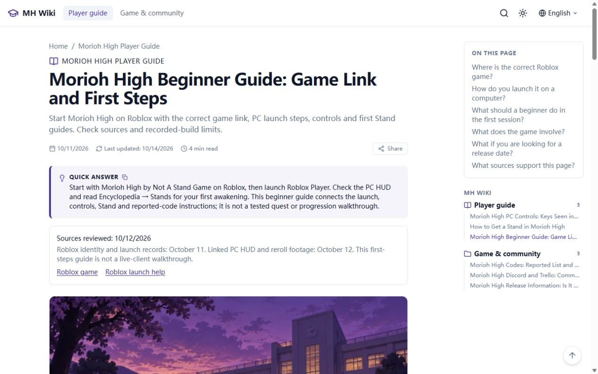

# SEO + GEO 网站审计

> 后续指示（2026-10-14）：站主要求取消Adsterra及GA4的同意前置；当前本地版本自动加载并移除选择横幅。本文此前同意门控检查是本轮SEO阶段的历史记录；最新广告行为与验证见 reports/automatic-ads-2026-10-14.md。生产仍未部署。

审计日期：2026-10-14，Asia/Shanghai。生产基线 source `c02e4fd73a22f8eb53e6f7b9c544ca11da842739`；本地起点 `b1f7fe9`；修改分支 `codex/seo-geo-2026-10-14`。本轮仅本地修改和公开只读研究，未部署、未推送、未修改外部账号/DNS。

## 结论与证据范围

没有发现已证实的P0站点抓取故障。23个正常生产路由均200；HTTP主域301到HTTPS，缺尾斜杠308到规范URL，随机不存在路径404。所有页面一个H1，无观察到的标题层级跳跃，Title/Description/Canonical完整；正文直接出现在静态HTML中，六篇MDX不依赖执行JavaScript。

主要问题是内容覆盖和身份标记：新手入口偏向启动教程；来源日期与编辑日期不够显眼；模板把站名当成Organization和匿名组织作者；导航归档nofollow；404模板没有显式noindex。均已有本地修正。真实Google收录、曝光与AI引用没有获得新数据，不能归因于单一技术设置。

原15词用户研究及历史KD/Trends数字完整保留。下表的质量判断来自本次静态HTML、代码、已有E01–E24证据和新增E25；不是当前游戏客户端实测。

## 逐页审计表

URL | 目标关键词/意图 | 当前问题或限制 | 优先级 | 本地修改方案/状态 | 验证方法
---|---|---|---|---|---
[/](https://moriohhighguide.wiki/) | morioh high wiki / guide | 新手入口不够明确；站点与游戏实体混用 | P1/P3 | 更新新手入口；保留六篇入口；WebSite稳定ID，VideoGame URL改为真实Roblox入口 | 静态首页/浏览器点击/Schema
[/guides/how-to-play/](https://moriohhighguide.wiki/guides/how-to-play/) | morioh high beginner guide / PC launch | 只有启动与身份说明，缺首轮导航；未实测完整进度 | P1 | 同URL改为first-steps新手指南；增加五步检查表及相关链接，保留进度限制 | 来源E01/E16/E19/E20、静态表、移动端
[/guides/how-to-get-a-stand/](https://moriohhighguide.wiki/guides/how-to-get-a-stand/) | how to get a stand in morioh high | 已有有效获取答案；失败条件不易比较；旧录像不等于当前版本 | P1 | 增加五种失败情形检查；保留概率/兼容度/更换成本的出处及历史日期 | E17/E18/E20、源链接、静态正文
[/guides/controls/](https://moriohhighguide.wiki/guides/controls/) | morioh high controls | 仅早期录像PC键位；其他设备未验证 | P1 | 增加显眼的10/12来源复查说明及0:05证据链接，不扩写未知键位 | E19/E22、SourceNote/citation一致
[/resources/codes/](https://moriohhighguide.wiki/resources/codes/) | morioh high codes / how to redeem | 兑换未实测；奖励有冲突；入群说明缺失 | P1 | 保留7个reported码/奖励省略/10/13快照；新增GamesRadar入群说明与FAQ，明确单一二手报道和未实测 | E24/E25、七卡/FAQ/来源审计
[/resources/community-links/](https://moriohhighguide.wiki/resources/community-links/) | morioh high discord / trello | Discord所有权、Trello网址未证实 | P2 | 增加10/11历史检查说明及对应来源，不虚构官方链接 | 历史E来源与可见链接一致
[/resources/release-information/](https://moriohhighguide.wiki/resources/release-information/) | morioh high release date | 确切发布日期仅二手报道；活动状态历史 | P2 | 增加10/11来源复查说明；保留创建/上线/观察日期区分 | 原始API/BloxInformer记录
[/faq/](https://moriohhighguide.wiki/faq/) | Morioh High beginner / reliable information | 缺新手答案 | P1 | 添加真实覆盖范围的新手问答，与可见FAQ schema同步 | JSON-LD/可见答案
[/about/](https://moriohhighguide.wiki/about/) | 站点身份/编辑原则 | 无真实组织主体仍输出Organization | P3 | 移除虚构出版主体；原非官方声明和编辑说明保留 | JSON-LD审计
[/contact/](https://moriohhighguide.wiki/contact/) | 站点公开联系方式 | 邮件实际实收未验证；用户此前要求跳过 | P3 | 保留公开域名地址，移除无依据组织schema；不要求重测邮箱 | 静态mailto/原隐私范围
[/copyright/](https://moriohhighguide.wiki/copyright/) | 版权与原创图片说明 | 组织schema问题 | P3 | 移除无依据组织schema，保留原版权披露 | 静态HTML
[/privacy-policy/](https://moriohhighguide.wiki/privacy-policy/) | 广告/统计隐私披露 | 组织schema问题；广告填充与收入未验证 | P3 | 移除无依据组织schema；保留Adsterra/GA4同意规则 | ad-build/consent测试
[/terms-of-service/](https://moriohhighguide.wiki/terms-of-service/) | 使用条款 | 组织schema问题 | P3 | 移除无依据组织schema，保留原条款 | 静态HTML
[/guides/](https://moriohhighguide.wiki/guides/) | 导航，不争抢正文关键词 | noindex,nofollow降低导航意图一致性 | P3 | noindex,follow；继续排除Sitemap | robots meta/构建内链
[/resources/](https://moriohhighguide.wiki/resources/) | 资源导航 | 同上 | P3 | noindex,follow；不新增空文章 | robots meta/构建内链
[/recent/](https://moriohhighguide.wiki/recent/) | 更新导航 | 同上 | P3 | noindex,follow；不因检查修改日期 | robots meta
[/tags/](https://moriohhighguide.wiki/tags/) | 标签导航 | 薄归档，不应独立竞争 | P3 | noindex,follow；保持Sitemap排除 | robots meta
[/tags/codes/](https://moriohhighguide.wiki/tags/codes/) | 标签导航 | 聚合页与原文章高度重叠 | P3 | noindex,follow；保留用户浏览入口 | robots meta/内链
[/tags/community-resources/](https://moriohhighguide.wiki/tags/community-resources/) | 标签导航 | 聚合页与原文章高度重叠 | P3 | noindex,follow；保留用户浏览入口 | robots meta/内链
[/tags/getting-started/](https://moriohhighguide.wiki/tags/getting-started/) | 标签导航 | 聚合页与原文章高度重叠 | P3 | noindex,follow；保留用户浏览入口 | robots meta/内链
[/tags/release-information/](https://moriohhighguide.wiki/tags/release-information/) | 标签导航 | 聚合页与原文章高度重叠 | P3 | noindex,follow；保留用户浏览入口 | robots meta/内链
[/tags/roblox/](https://moriohhighguide.wiki/tags/roblox/) | 标签导航 | 聚合页与原文章高度重叠 | P3 | noindex,follow；保留用户浏览入口 | robots meta/内链
[/tags/stands/](https://moriohhighguide.wiki/tags/stands/) | 标签导航 | 聚合页与原文章高度重叠 | P3 | noindex,follow；保留用户浏览入口 | robots meta/内链
[/404.html](https://moriohhighguide.wiki/404.html) | 错误恢复 | 模板缺显式noindex；生产未知路径仍正确404 | P3 | 新增noindex,nofollow；不改错误恢复或搜索 | 构建404 meta/生产随机404基线

## 抓取与索引

robots.txt放行全部路径并指向正式Sitemap；13个可索引URL，10个归档排除，404及7个广告iframe资产排除。Canonical均为正式域名和稳定原URL，English-only；不新增多语言hreflang。Googlebot/Bingbot/OAI-SearchBot/PerplexityBot四种UA访问Stand指南均200且取得核心答案。这是UA探测，未使用真实爬虫IP，不能证明真实爬虫通过WAF、已索引或被AI引用。没有修改外部WAF规则。

既有GSC报告曾为Couldn’t fetch/Unknown/0discovered，本轮没有访问私有GSC报表，该历史状态不当作当前结果。GA4既有测试采集证据保留；本轮未测自然搜索访问。

## Schema与GEO

Organization仅在明确配置真实主体时输出；目前未配置，因此省略网站Organization、未知author/publisher。保留真实游戏开发者实体、WebSite、Article、BreadcrumbList和可见FAQPage。Article新增inLanguage、isPartOf和可见来源citation；不把来源复查日期写成游戏版本或成功测试。当前文章没有视频frontmatter，所以未生成VideoObject；在确认真实上传日期等必需数据之前不新增它。

[Google AI指南](https://developers.google.com/search/docs/appearance/ai-features)说明常规SEO仍适用，不要求特别AI文本文件或Schema。llms.txt继续从现有文章自动生成，仅澄清独立站身份和证据限制。FAQPage用于描述可见问答，不承诺富结果；[Google更新记录](https://developers.google.com/search/updates)已经记录FAQ富结果停止展示。

## 性能与体验

新来源面板只输出HTML，没有新增客户端脚本、依赖或图片。原Astro响应式WebP封面、Pagefind按需加载、广告同意门控保留。桌面1280×800、移动390×844真实浏览器无整页横向溢出；两张新手表宽343px。Pagefind beginner查询1结果并实际打开旧URL。复制按钮出现Copied!反馈，但Browser Use虚拟剪贴板没有数据，实际剪贴板内容未独立验证，不据此修改原复制实现。

公开PageSpeed无key请求网络失败；没有Lighthouse分数、CrUX字段数据或真实Core Web Vitals，不声称性能100或绿色CWV。本地与生产HTML压缩体积的差异仅作为传输体积对比，不等同用户加载性能。

## 证据文件

- [生产路由/跳转/Schema基线](../research/seo-geo-2026-10-14/production-audit.json)
- [本地静态验收及体积差异](../research/seo-geo-2026-10-14/local-verification.json)
- [真实浏览器验收](../research/seo-geo-2026-10-14/browser-verification.json)
- [公开API/趋势/性能请求](../research/seo-geo-2026-10-14/public-probes.json)
- [修改前决策](../research/seo-geo-2026-10-14/decisions-before-edit.md)

