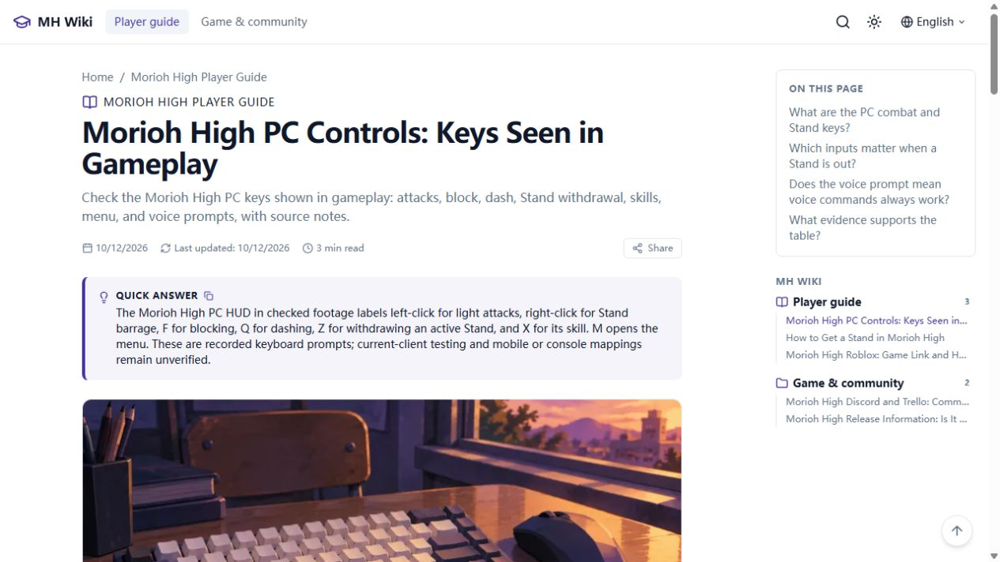

# Morioh High Wiki 实际交付报告

2026-10-13增量：用户再次确认`morioh high codes`，已去重列入当前P1核验重点；累计关键词37/30/7不变。E23复查仍有二手奖励冲突及实际兑换证据缺口，Codes页面暂缓。此次仅研究记录更新，以下正式部署、12个Sitemap网址及7编辑页面的验收日期/版本仍为2026-10-12，未新增Google量化数据。详见[本次增量](../research/keyword-user-signal-2026-10-13.md)。

2026-10-12，Asia/Shanghai。**质量合格的限定首版已在正式域名上线并验收**；完整游戏百科未完成，13个缺证据意图暂缓。各步骤按已完成、已验证、未完成、未验证、外部处理分别记录。

## 1. AnvilWiki 版本及来源

已验证：[AnvilWiki](https://github.com/PNGTRID/AnvilWiki)2.37.0，commit b00859a524a176d60f3982c71b318ac11bc2fd5b，MIT。保留LICENSE和归属，实际使用官方apply-template、Astro7.3.2/MDX8.0.1/Pagefind及原生文章、导航、SEO、广告组件；英语、静态构建、广告关闭。Node22.19.0/pnpm11.1.1，Node要求>=22.13。README/AGENTS/docs/实际技能核对见[模板来源](../research/template-provenance.md)。

## 2. GitHub 与实际代码

已完成并验证：[jjasnek-ops/moriohhigh-wiki](https://github.com/jjasnek-ops/moriohhigh-wiki)，按用户最新指示创建在新账号下的独立公开仓库，完整代码历史保留。GitHub CLI当前账号、全局HTTPS凭据选择、全局及项目Git作者均已切换为jjasnek-ops（公开noreply）。线上源代码 **173c393f772174db373ebac0a358d60c6cddfed8**；[CI38201586065](https://github.com/jjasnek-ops/moriohhigh-wiki/actions/runs/38201586065)成功。旧账号仓库保留为历史，不再用于新操作；最终报告属于后续记录提交，不冒充线上源代码。凭据未写入仓库。

## 3. Cloudflare Pages

已完成并验证：项目moriohhigh-wiki，生产部署 **08de0189-b4c1-43a2-989f-299458e12d63**；[不可变部署](https://08de0189.moriohhigh-wiki.pages.dev)。API deploy stage成功，正式站原生marker匹配线上source。[平台地址](https://moriohhigh-wiki.pages.dev/)保留，Canonical指向正式域名。使用Wrangler direct upload；GitHub CI已配置，未宣称GitHub自动生产部署已集成。

## 4. 正式域名及邮箱

**已完成并验证**：[moriohhighguide.wiki](https://moriohhighguide.wiki/)，用户已在Spaceship购买并授权。Cloudflare Free zone和Pages domain均active，HTTPS及所有有效页面验收通过。NS实际保存armfazh.ns.cloudflare.com/laura.ns.cloudflare.com，公开查询一致；新DNSSEC DS已保存，Google DoH A/MX/NS/TXT/DS均AD=true。CF DNSSEC状态接口最后仍pending，保留这个差异待复查。

公开邮箱 **contact@moriohhighguide.wiki** 精确转发到用户已验证的私有Gmail。规则enabled且读回正确；服务ready/enabled/synced，真实MX/SPF/DKIM已安装，公开MX/SPF验证。网站原生联系页已显示可点击mailto。**实际收信未验证，用户明确要求跳过；域名地址发信未配置**。私有Gmail不公开，未发送测试邮件。

未购买或付款、未改其他域名。实际订单费用/Premium/续费金额未知；历史标准.wiki续费预算风险保留。[域名研究](../research/domain-selection.md)、[接入回执](domain-binding.json)、[邮件配置](email-routing.json)、[恢复说明](domain-email-handoff.md)。

## 5. 关键词研究总数及有效口径

累计37研究记录/30相关候选/7排除项；原36/29/7基线保留，新增Stand rerolls候选合并已有攻略，不另建重复页。30不是实测月搜词数；本轮没有取得新搜索量/KD。Suggest7条当前信号，新月搜/KD未取得，保持未知。主词Google样本9自然结果和图片包，US/en参数但登录/位置可能影响；实际样本竞争判断2/5，不替代历史KD47.7。其他词未完成Google前十实查，不编造评分。7/30天Trends含GPTs比较返回429；实时上涨和长期需求未验证。Similarweb/付费API数据未取得。

## 6. 用户原研究继承

已完成：15词原始数字、KD、热度、历史SERP、口径和限制完整保存在[Markdown](../research/user-keywords-2026-10-11.md)及[JSON](../research/user-keywords-2026-10-11.json)。新研究独立记录，未覆盖原始数字；未收录、无数据、实际零月搜、Trends相对零保持区别。

## 7. 最终页面矩阵

20独立意图，7发布/13暂缓；4完整限定答案、3部分答案。政策、归档和404不计精品攻略。最小有效答案、主次词、证据、内链、频率和状态见[页面矩阵](../research/page-matrix.md)，[架构](../research/site-architecture.md)与[内链计划](../research/internal-link-plan.md)。

## 8. 实际发布页面与URL

| 编辑页面 | 实际URL | 回答范围 |
|---|---|---|
| Wiki首页 | [首页](https://moriohhighguide.wiki/) | 游戏身份、入口、可靠内容导航；完整限定答案 |
| How to play | [启动指南](https://moriohhighguide.wiki/guides/how-to-play/) | 正确游戏入口与Roblox启动；完整限定答案，不冒充进度路线 |
| How to get a Stand | [Stand获取](https://moriohhighguide.wiki/guides/how-to-get-a-stand/) | 文档化战斗/Arrow方法、100 Rerolls更换费用及证据边界；完整限定答案 |
| PC controls | [操作键位](https://moriohhighguide.wiki/guides/controls/) | 同游戏已读录像9项PC输入；部分答案，当前客户端及其他设备未测 |
| Release information | [发布信息](https://moriohhighguide.wiki/resources/release-information/) | 活动状态与创建日期区别；部分答案，官方确切发布日期未知 |
| Community resources | [社区入口](https://moriohhighguide.wiki/resources/community-links/) | 匹配群组/有效邀请；部分答案，官方Discord所有权/Trello未知 |
| FAQ | [FAQ](https://moriohhighguide.wiki/faq/) | 8项身份、入口、资源答疑；完整限定答案 |

另有About、Privacy、Terms、Copyright、Contact，合计12允许索引URL；21正常HTML路由，加404共22构建HTML。导航/标签归档noindex且排除Sitemap。Contact服务启用后已允许索引，不计新增机制攻略。

## 9. 暂缓页与理由

| 候选 | 缺少的核心证据 |
|---|---|
| Beginner guide | 当前普通玩家起步目标与实测路线 |
| Stands guide | 完整当前roster与能力数据 |
| Progression | 已实装里程碑/解锁 |
| Map / locations | 当前地图/路线 |
| NPCs | 名称/位置图鉴 |
| Quests | 前置/任务/奖励列表 |
| Abilities | 当前技能/数值 |
| Combat | 同游戏控制和战斗测试 |
| Items | 完整功能/来源；Arrow窄答案已并入Stand页 |
| Codes | 开发者来源及成功兑换验证；媒体状态冲突 |
| Tips | 独立实测选择，会重复未验证beginner内容 |
| Troubleshooting | 可复现游戏特有问题；启动问题已合并 |
| Tier list | 当前roster和可重复对比测试 |

未发布空壳路由，Script/作弊和无关JoJo城镇百科排除。历史相对热度0不等于真实零搜索。

## 10. 搜索需求覆盖

覆盖品牌/Wiki/Roblox入口、首次Stand获取/更换、限定PC操作、发布日期和Discord/Trello资源意图。入口/Discord有当前Suggest，Stand有同游戏视频需求信号；FAQ独立需求未量化。专门Wiki覆盖仍薄只是机会假设，准确月搜、稳定上涨及多个独立机制长尾未证实。Codes不作唯一流量策略，JoJo词量不计本游戏需求。

## 11. 事实证据审计

限定范围已审计：[E01–E22台账](../research/evidence-ledger.md)、[内容审计](content-audit.md)。[官方游戏](https://www.roblox.com/games/111838814545019/Morioh-High)，Place111838814545019/Universe10768944846；开发者Not A Stand Game/group403864872。

E17录像0:10实际可读同游戏Encyclopedia，E18另一玩家0:50–1:05 Arrow争夺佐证。1-in-10、一分钟限制、100%兼容度来自可读UI；概率未独立实测，当前客户端/准确build未验证。Arrow地点、刷新、价格不猜测，admin工具不作普通进度证据。新增E19实际读取Iron0:05九项PC HUD；E20重新读同游戏UI的100 Rerolls，更换随机且排除当前Stand，未验证10 Arrow Shards替代费。E21为官方身份活动快照、E22为平台Voice边界。控制表不猜测Z召唤、Ctrl具体锁定模式、技能冷却或当前客户端。无其他游戏/原作机制搬运、未验证Codes或复制竞争文章；非官方声明和自制视觉保留。

## 12. 视觉审计

2026-10-12图片增量已完成并上线：原4幅及本轮新增键盘封面，共5幅内置image_gen原创AI辅助插画；首页主视觉、正文封面、首页/列表/相关文章缩略图、独立新版分享图、Stand证据流程图。图注和ALT明确说明非游戏截图/地图/实际物品模型；没有凭插画推断游戏内容。

本次相同构建真实IAB桌面1280×720和手机390×844检查：首页图片加载、图注、响应式布局，Stand双路径流程图可读，手机375scrollWidth<=390innerWidth。正式站主视觉和四张图片卡片实际已可见并保存截图。32线上图片资源HTTP200且与验收构建逐字节一致，尺寸/ALT/分享图核对0错误。[图片审计与素材/提示词](image-improvements-2026-10-12.md)。

正式Controls首屏/封面已实际查看，390宽手机9项表格完整可读。桌面controls-live-desktop.png、手机controls-live-mobile-table.png已保存；本地及正式Pagefind controls查询各返回4结果，正式结果点击后实际进入新增页。原正式Contact、mailto和搜索验证保留；未宣称真实手机/Lighthouse/Core Web Vitals测量。

## 13. 技术检查

| 请求脚本 | 正式域名版本结果 |
|---|---|
| pnpm check | 已验证通过；137files、0errors/warnings/hints |
| pnpm lint | 已验证通过 |
| pnpm test | 已验证通过；18suites、244passed/1skipped |
| pnpm check-config | 已验证通过；英语/分类/正式origin一致 |
| pnpm check-content | 已验证通过；5MDX |
| pnpm check-links | 已验证通过；22HTML/505内链 |
| pnpm check-sitemap | 已验证通过；本地及正式站12/12 URLs200 |
| pnpm build | 已验证通过；22HTML、Pagefind5文章 |

本轮普通check-i18n通过，此前strict检查记录保留；构建SEO22HTML/12indexable/12sitemap/0failures；线上21HTML/28目标/0failures，包括HTTPS、Canonical、robots、noindex、404和搜索资源。[日志与限制](technical-audit.md)。7个上游演示/营销测试保留但不适用本站，列为templateOnlySuites；一个已移除FORKER块测试跳过。构建不代替事实审计。

## 14. Sitemap

[index](https://moriohhighguide.wiki/sitemap-index.xml)与[child](https://moriohhighguide.wiki/sitemap-0.xml)已验证200、正确XML类型/命名空间，12存在且允许索引URL均200，无暂缓空页。robots允许抓取并列正式Sitemap。旧Pages版本的10URL IndexNow202为历史回执，未冒充本次正式站提交或Google收录。

## 15. GSC与GA4

GSC正式域名属性 **sc-domain:moriohhighguide.wiki**，DNS TXT所有权已验证，index Sitemap提交成功对话框已观察。**初始处理报告仍Couldn't fetch/Unknown/0discovered**；提交不等于处理/收录。原Pages属性及其成功Google live test为历史独立证据，不冒充正式域名Google抓取测试。[正式GSC回执](search-console-formal.json)。

GA4已有property558434763/stream16106218705/G-MLLG5CEMCG，网址已更新为正式域名且读回。原生同意前/拒绝不加载Google，正式站允许后正确标签实际加载；正确属性Realtime收到 **1测试用户、1次Contact页面浏览、first_visit/page_view/session_start**。设置页inactive告警与实际Realtime证据分别保留，测试访问不是自然流量。[正式GA4回执](analytics-formal.json)。私有Google控制台截图保存在本地.tools/screenshots，不上传公共仓库。

## 16. Google收录及曝光

未验证：索引页数、排名、自然点击/曝光、GA4 Organic Search；没有广告审批、富媒体展示、RPM或收入声明。域名生效、提交成功、HTTP200和测试访问不能替代Google数据。

## 17. 授权与付款阻塞

GitHub、Cloudflare Pages/正式域名、GSC、GA4已通过现有授权完成。原Spaceship登录/NS切换和zone-create Token权限问题已解决，无扩权，无付款或新增付费服务。Google处理和真实搜索数据待外部结果；域名实际费用未知。邮箱实收测试由用户明确要求跳过，不继续作为阻塞询问。

## 18. 必要维护

4个原单次检查已创建、此次更新正式站地址并读回验证：10/14、10/18、10/25、11/8 12:00 Asia/Shanghai，morioh-high-3/7/14/28，按最初10/11首版日期保留日程。未来运行未发生，依赖本机/应用和已授权账号。无事静默，不自动重写/生成文章。

优先复查正式GSC Sitemap处理和CF DNSSEC pending状态，观察真实收录/曝光/Organic Search。仅重大游戏变化、重要事实错误、明确新需求、GSC缺口或技术故障才更新；稳定URL。[维护政策](../MAINTENANCE.md)。

## 19. 商业价值与剩余风险

这是已落地、低维护的真实静态SEO实验，支持品牌/入口/首次Stand及更换/录像PC输入的限定需求。商业价值未证实；风险仍包括实时热度/月搜未知、当前客户端未测、完整机制资料不足、Sitemap处理未成功和实际域名续费预算未知。不以页面数量或预测流量追加采购/批量内容。

分别观察未索引、索引后低排名、有排名但需求小、有曝光但CTR低。若热度下降、索引后长期无曝光、独立长尾有限、竞争占优或维护过高，停止追加投入；低成本技术正常站点可以保留。研究、代码、测试、决策和回执已保存，[恢复状态](current-delivery-status.md)支持继续，不重复初始化。正式站工程和上线验收已完成；完整游戏百科、邮件实收、Google商业效果未冒充完成。
